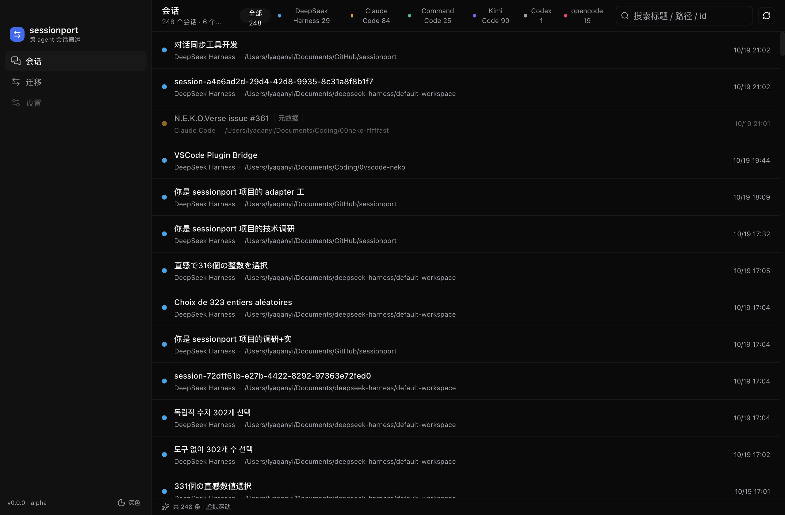
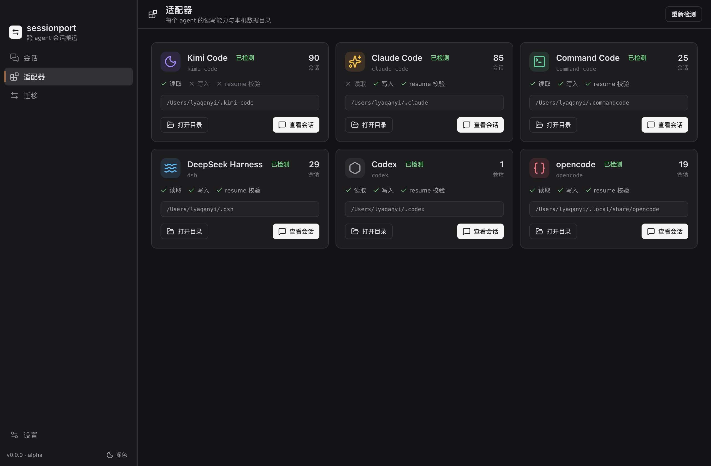
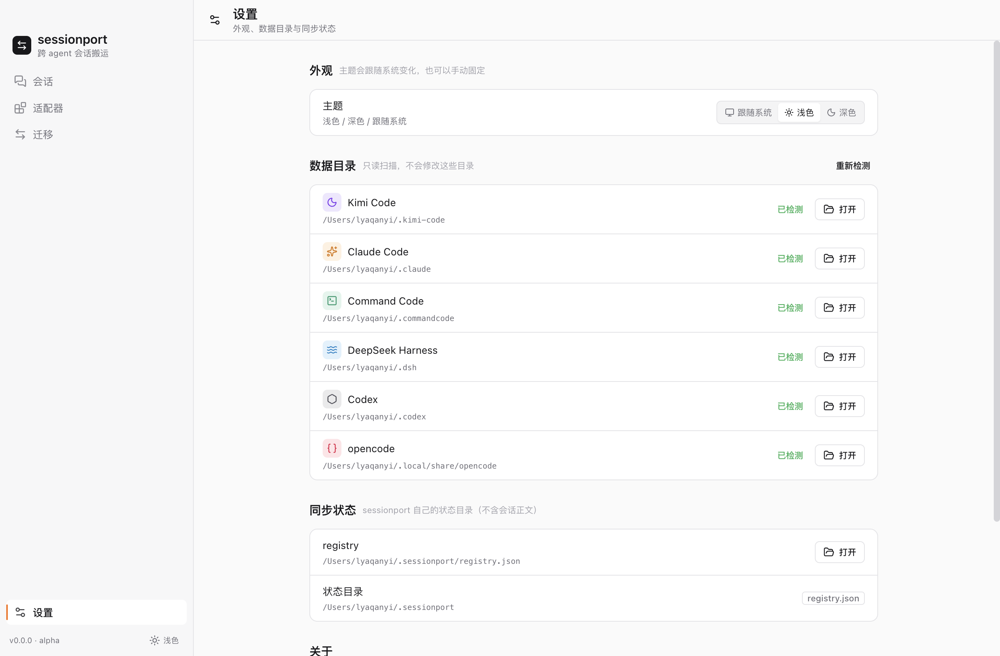
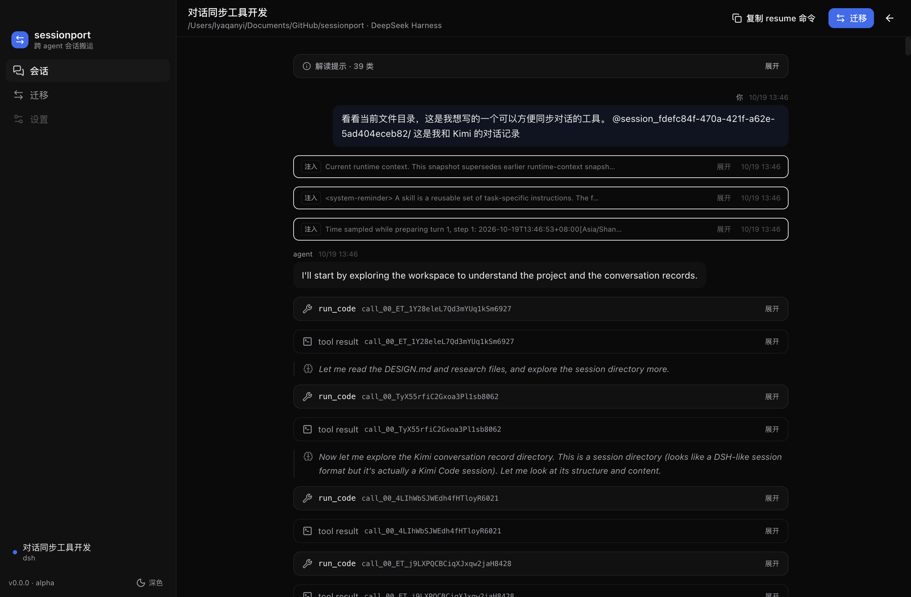
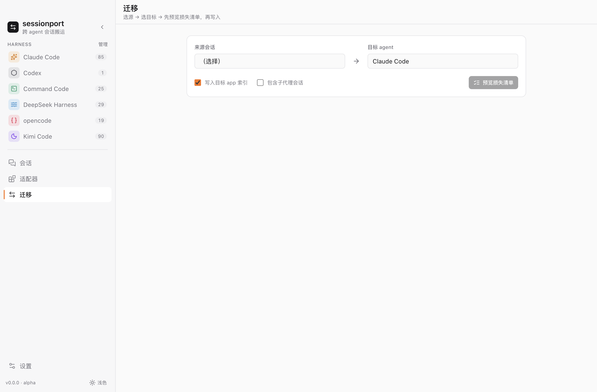
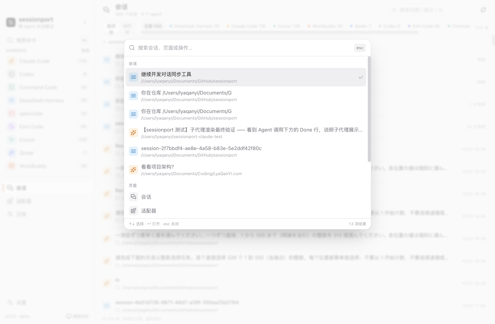

# sessionport

**English** | [简体中文](README.zh-CN.md)

[](https://github.com/LyaQanYi/Sessionport/actions/workflows/ci.yml)
[](https://www.npmjs.com/package/sesport)
[](LICENSE)

**Move a live AI coding-agent session from one CLI to another — and keep going.**
A conversation started in Kimi Code becomes a Claude Code session you can `/resume`.
Not a pasted transcript, not a summarized context blob: a native session the target CLI loads by itself.

> **Status: alpha.** Nine adapters: `claude-code`, `command-code`, `dsh`, `codex`, `opencode`,
> `cursor`, `qoder` (read/write) and `kimi-code`, `workbuddy` (source). Every export prints exactly what it lost.
> Design notes: [DESIGN.md](./DESIGN.md). Format research: [research/](./research/).

## Why

Every agent CLI keeps its conversation history in a private format. Switching tools means losing the thread.
Existing tools either translate one direction, or re-feed a summarized context blob. sessionport does neither:

- **IR**: a normalized append-only event stream (`message` / `reasoning` / `tool_call` / `tool_result` / `boundary`), chained by `parentId`.
- **Adapters**: one per agent, responsible only for `native -> IR` and `IR -> native`.
- **Loss list**: every export reports what could not be preserved, and whether it is a design trade-off or a known gap.
- **Native resume**: the only acceptance test that matters — the target CLI must load the session and continue it.

## Install

Requires **Node.js >= 24** (TypeScript sources are executed via Node type stripping; the published CLI is a
single bundled JS file).

```bash
npm install -g sesport          # commands: sesport / sesp / sessionport
sesport inspect "kimi:./session_.../"
```

The desktop app is distributed separately as an unsigned macOS `.dmg`/zip (see the releases page or
`pnpm dist:desktop` from a checkout).

## Quick start

Requires Node >= 22.18 (TypeScript runs directly via built-in type stripping; no build step).

```bash
# from a checkout (development / hacking on adapters):
git clone https://github.com/LyaQanYi/Sessionport && cd sessionport
pnpm install

# 1. What is in this session?
node packages/cli/src/index.ts inspect "kimi:./session_fdefc84f-.../"

# 2. Port it (writes a native session for the target CLI)
node packages/cli/src/index.ts push "kimi:./session_fdefc84f-.../" --to claude-code

# 3. Prove the target can resume it (real model call)
node packages/cli/src/index.ts verify --agent claude-code --cwd /path/to/project --id <session-id> --resume

# The whole chain, both directions, in one shot:
./scripts/demo.sh              # Kimi -> Claude Code
./scripts/demo-interop.sh      # Command Code <-> DeepSeek Harness
```

### Re-push safely

`sync` never silently overwrites turns you added in the target app:

```bash
node packages/cli/src/index.ts sync "dsh:<session-dir>" --to command-code --register
```

| Situation | Behaviour |
|---|---|
| first push / target file gone | fresh write |
| source and target unchanged | **no write** (idempotent) |
| source grew, target untouched | rewrite + update registry |
| **target grew** (you continued there) | **refused**; `--fork` keeps the old session, `--force` overwrites |

State lives in `~/.sessionport/registry.json` (`--state <dir>` to override).

## Supported agents

| Agent | Read | Write | Resume verified | Against |
|---|---|---|---|---|
| Kimi Code | ✅ `state.json` + `agents/*/wire.jsonl` | — | source only | CLI 2.1.1 / format v2 |
| Cursor | ✅ `state.vscdb` composerData/bubbleId | ✅ new composer + header | ✅ app-visible; edit cards + diff (manual check) | 3.25.9 |
| Qoder | ✅ `~/.qoder-cn/projects/*.jsonl` | ✅ new transcript file | ✅ Qoder SDK `listSessions/listSubagents` (desktop task list is server-backed) | 1.1.69 |
| WorkBuddy | ✅ `~/.workbuddy/projects/*.jsonl` | — | source only | 5.8.3 |
| Claude Code | — | ✅ JSONL session files | ✅ `claude --resume` TUI (matrix) | CLI 2.1.312 |
| Command Code | ✅ `projects/<slug>/<uuid>.jsonl` | ✅ + desktop registration | ✅ `cmd -p --session` | 1.82.3 |
| DeepSeek Harness | ✅ multi-frame zstd event log | ✅ native workspace layout | ✅ headless load (matrix) | 5.8.3 (format v4) |
| Codex | ✅ `sessions/**/rollout-*.jsonl` | ✅ + `threads` / index registration | ✅ `codex exec resume` | 0.163.0 |
| opencode | ✅ `opencode export` JSON | ✅ `opencode import` | ✅ `opencode run --session` | 1.19.3 |

Sub-agent sessions: pass `--include-children`. DSH and Claude Code keep the native parent/child tree
(Claude Code writes `<sessionId>/subagents/agent-<id>.jsonl` + `meta.json`); Command Code has no parent
concept, so children are written as independent sessions (content preserved, relationship reported as lost).

Verification is reproducible: `pnpm matrix` writes each pair into an isolated target home and then loads the
result in the target itself where an entry point exists (`claude --resume` TUI, DSH headless, Cursor/Qoder
structural + SDK). Latest run: [research/verification-matrix-2026-10-29.md](research/verification-matrix-2026-10-29.md).

## How fidelity works

Reading and writing are asymmetric, so losses are tracked separately:

- **notices** (per session, on read): what the source had but IR does not model — UI mirrors, runtime/config events,
  harness-injected messages, reverted turns.
- **losses** (per export, on write): what IR had but the target cannot represent.

Losses are either **accepted design trade-offs** (no mapping exists, or we deliberately do not carry it — e.g. model
bindings are never migrated; the target keeps its own default model and system prompt) or **actionable capability gaps**
(sub-agent relationships on targets without sidechains, image attachments, branch boundaries). See
[DESIGN.md §6.1](./DESIGN.md).

## Commands

```
sessionport inspect <source>
sessionport pull  <source> [--out ir.json]
sessionport push  <source> --to <agent> [options]
sessionport sync  <source> --to <agent> [options]
sessionport verify --agent <agent> [options]
```

Sources: `kimi:<dir>`, `claude:<path|id>`, `commandcode:<path|id>`, `dsh:<dir>`, `codex:<path|id>`,
`opencode:<path|id>`, `cursor:<composerId>`, `qoder:<path|id>`, `workbuddy:<path|id>`, or an IR `.json`.
Targets: `claude-code`, `command-code`, `dsh`, `codex`, `opencode`, `cursor` (needs `--confirm-real`), `qoder`.

Registers into the target app instead of just writing files: `--register` (Command Code desktop list / DSH workspace /
Codex `threads` + `session_index.jsonl`).

Large sessions: the `dsh` target supports `--slim` — tool results/call arguments are truncated, older steps keep
only messages, and reasoning is dropped, so the imported session fits the target model's context window
(each cut is reported in the loss list).

The desktop migration page exposes the same choice for the `dsh` target (compressed / full / slim) plus a
summary engine selector (extractive / Claude / Codex) — LLM summaries stay opt-in and default to extractive.

`--compact` is the lossless-log variant: the full event log is kept and a **native DSH compaction chain**
(`compaction/start` → `compaction/summary` → checkpoint `surfaceOp: replace` → `compaction/end`) is written,
so the model only sees the summary plus the most recent steps. The history stays recoverable and can be
compacted again by DSH later. Summaries are extractive by default; `--summary-llm claude|codex` reuses an
already-authenticated local CLI to produce a multi-round LLM summary (segments are summarized, then merged,
until they fit the budget).

### Reuse the target's official importer

ZCode and Qoder ship their own migration flows, which also carry memories/MCP/skills and are
maintained by the vendor. Prefer them when available:

```bash
sessionport import --into zcode claude:<id>     [--open] [--verify]
sessionport import --into qoder workbuddy:<id>  [--open] [--verify]
```

| Pair | Official path | sessionport role |
|---|---|---|
| Claude Code → ZCode | ZCode onboarding / Settings → migrate sessions (scans `~/.claude/projects`) | ensure the Claude transcript exists, guide, verify against `tasks-index.sqlite` |
| WorkBuddy → Qoder | Qoder Settings → Data import → WorkBuddy | confirm the source store, guide, verify against `~/.qoder-cn/projects` |
| Claude Code → Cursor | none (only a feature request) | direct write: `push --to cursor --confirm-real` |

Details and evidence: [research/official-import-paths.md](./research/official-import-paths.md).

## Desktop app (early)

An Electron shell lives in `apps/desktop` — the renderer never touches the filesystem; all adapter work happens in
the main process (which imports the same `@sessionport/*` packages as the CLI).

```bash
pnpm install
pnpm dev:desktop     # electron-vite dev (opens a window)
pnpm build:desktop   # production bundles -> apps/desktop/out

# distribute: .app + dmg + zip under apps/desktop/release (unsigned)
pnpm dist:desktop
pnpm --dir apps/desktop dist:dir   # unpacked .app only, faster

# headless smoke (no window; useful in CI)
cd apps/desktop && SESSIONPORT_SMOKE=1 ./node_modules/.bin/electron .
```

The packaged app is unsigned by default (`mac.identity: null`), so first launch needs
right-click → Open or `xattr -dr com.apple.quarantine`.

Current screens: session browser (all agents), reader (IR events, notices, resume command), migration with
dry-run loss preview before writing. The reader also lists sub-agent sessions (e.g. Claude Code's on-disk
subagent transcripts) and lets you drill into each one. Press **⌘K** (Ctrl+K) anywhere for a command palette:
search sessions across every harness, jump to a page, refresh the list or switch the theme.
IPC is a small typed allow-list with zod validation in the main process.

The UI is bilingual (zh-CN / en-US): it follows the system language by default and Settings → Language can
pin one; the choice is stored locally and applies immediately (loss/notice descriptions are translated by code).

The migration page also lists the vendor's own import flows (ZCode ← Claude Code, Qoder ← WorkBuddy)
with a one-click "open app" and a "verify import" button that reads the target app's own store.

| Session browser | Adapters | Settings |
|---|---|---|
|  |  |  |

| Reader | Migration |
|---|---|
|  |  |

| Command palette (⌘K) |
|---|
|  |

_Sessions group by project or time; the sidebar lists only the harnesses you enabled (auto-detected
from installed data directories, toggle them in Settings), and Settings stays pinned at the bottom.
Light and dark themes follow the system. UI design language credits:
[ACKNOWLEDGEMENTS.md](./ACKNOWLEDGEMENTS.md)._

## Architecture

```
packages/
├── core/                 # IR schema, loss collector, sync registry, sync planning
├── adapters/
│   ├── kimi-code/        # read
│   ├── claude-code/      # write + verify
│   ├── command-code/     # read/write/verify + desktop registration
│   ├── dsh/              # read/write/verify + workspace registration
│   ├── codex/            # read/write/verify + threads registration
│   ├── opencode/         # read/write/verify + import/export
│   ├── cursor/           # read/write/verify (state.vscdb composerData/bubbleId)
│   ├── qoder/            # read/write/verify (projects/<slug>/<uuid>.jsonl)
│   └── workbuddy/        # read/verify (projects/<slug>/<sessionId>.jsonl)
├── cli/                  # inspect / pull / push / sync / verify
└── e2e fixtures live in each adapter’s test/ folder

apps/
└── desktop/              # Electron shell (React + Vite + Tailwind + TanStack Query)
```

## Development

```bash
pnpm install
node --test packages/core/test/*.test.ts packages/adapters/*/test/*.test.ts packages/cli/test/*.test.ts
```

Live resume smoke tests are gated (they cost real model calls):

```bash
SESSIONPORT_CC_RESUME=1     pnpm test   # Command Code
SESSIONPORT_CODEX_RESUME=1  pnpm test   # Codex
SESSIONPORT_OPENCODE_RESUME=1 SESSIONPORT_OPENCODE_MODEL=opencode-go/glm-5.2 pnpm test   # opencode
```

## Contributing & security

Adapter contributions must include golden fixtures with the CLI version they were verified against —
see [CONTRIBUTING.md](./CONTRIBUTING.md). Please report vulnerabilities per [SECURITY.md](./SECURITY.md).

Session logs contain prompts, code, and sometimes secrets: sessionport is local-first with zero telemetry.

## License

[Apache-2.0](./LICENSE).